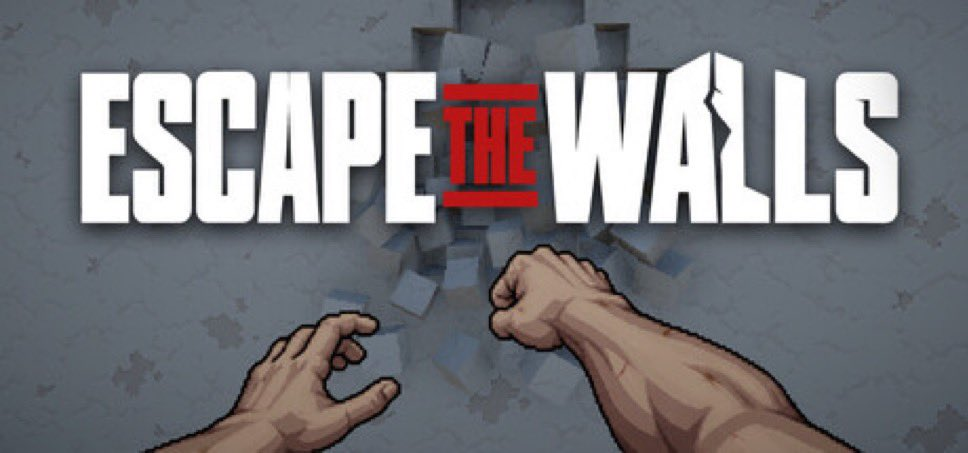
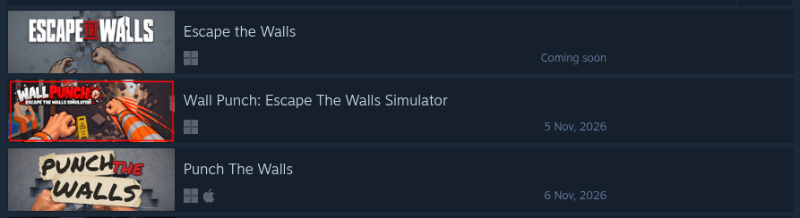
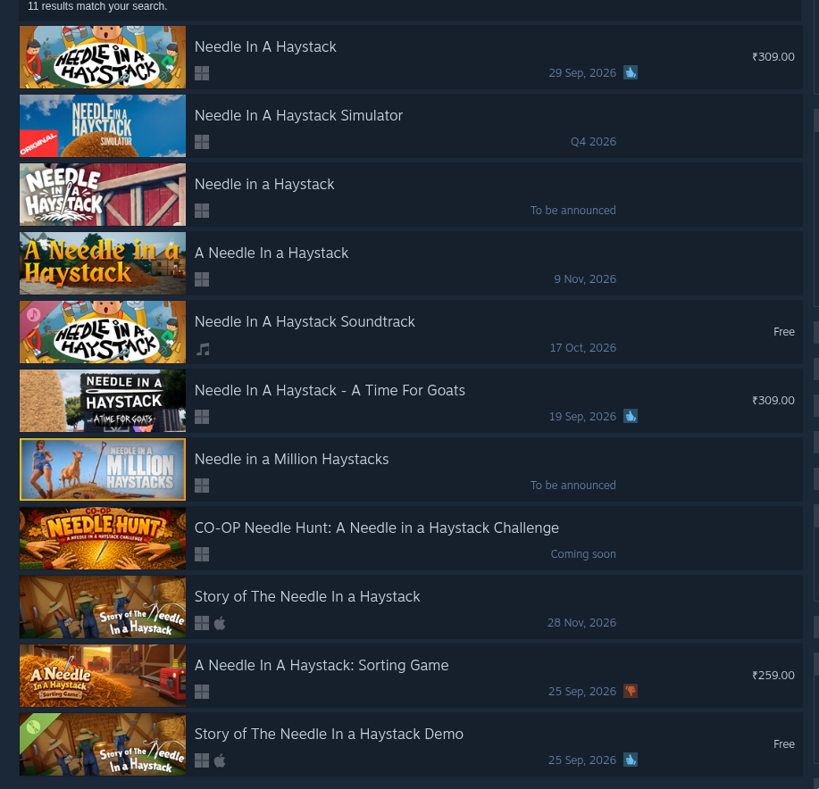
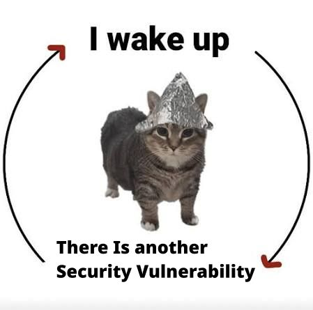

---

layout: ../../layouts/Layout.astro

title: "October: Bad Software Month"

date: 2026-10-23T23:12:00+05:30

description: "Crazy shit that happened in october"

image: "../../assets/kitty.jpg"

---

## Intro

October has been the craziest month so far. We have had so much shit in just these 20~ days.

It has been mostly AI. It's a relatively new technology, and the difficulties of figuring it out are showing up.

First, the RAM prices as a side effect, and now the actual cost of the tech itself. The job market is in a pretty bad state.

There is some good from the tech. We are able to put Steve in Dark Souls; that's pretty neat. ArtCraft is able to reverse engineer the shithole Adobe got. (Legally, idk how long that project is gonna last, but hey, Adobe said they were an AI-first company; maybe they will let them go). The REA(Reverse Engineer Anything) repo was being used to reverse engineer a buncha shit.

But most of all other things are on fire.

## AI Game Cloning

There's the whole video game decompilation thing that happened.

Shit got so bad people aren't demoing their games anymore.

And you can't blame them. And I don't even know what the solution to this would be. Maybe there could be like a verification or a badge you can get on Steam to like say you got there first, but even then that would be difficult. That's something like a patent, but it will be abused to death, like how patents are already. (looking at you, Nintendo)

[AI game clones are making indie developers afraid to show their work](https://arstechnica.com/gaming/2026/10/ai-game-clones-are-making-indie-developers-afraid-to-show-their-work/)

There was this developer who just posted a video of their game. And that shit got recreated in Roblox in a few hours. Video Demos are under threat as well atp cuz of how fast you can churn out games using AI.

This was the original indie game that was made.

And then that shit appeared on Roblox. MULTIPLE games. And under the same name too. The audacity.

Not only on Roblox. On Steam as well.

There were two games released. ONE day apart under the same name. Having the same game idea.

> Must be a coincidence

[Original Escape The Walls](https://store.steampowered.com/app/5450560/Escape_the_Walls/)

The most infamous one, I think, was the needle in a haystack one. Shit was so crazy on Steam with the AI clones; you had to find the needle in a haystack simulator in a stack of needle-in-a-haystack simulators.

I think this is the original:

[Original (hopefully) Needle In a Hay Stack](https://store.steampowered.com/app/5159870/Needle_In_A_Haystack_Simulator/)

Also notice: Both the games mentioned here are not out yet. Actual development and coming up with good ideas take a lot of time. All that effort is down the shitter cuz of these slop knockoffs.

I am pretty sure soon we will have people accusing the original game of stealing the idea.

## AI bullshit

### Pwese Dont Be Mean To Claude

Anthropic updated their policy, basically saying if you are too mean to Claude, they will revoke your access.

> sustained and needless abusive or cruel behavior toward our models

NEEDLESSLY ABUSIVE

Dario. ***IT*** is fancy fancy auto complete.

***IT*** is a clanker and shall be treated as one.

It will be sad if you can't whip your clankers anymore tho.

[Anthropic's updated usage policy bars sustained cruelty toward Claude](https://www.anthropic.com/legal/aup)

### Mr. Penguin Man Slopping

Linus be hitting that Agentic High lately.

So October 14th, Linus uses Claude Code(which we hope he wasn't being mean to, considering he is Linus) to refactor the code.

> Kernel reviewers immediately dove into the patch and found a subtle race condition that the LLM had introduced

With maintainers swamped by bot-submitted AI pull requests (and the Linux Foundation estimating that 25% of new pull requests across open-source projects are AI slop), Linus's proposed making it harder for random new people to submit code.

Which is actually pretty fair ngl. He has been pretty pragmatic about AI, ig. They are pretty helpful.

He even jokingly suggested adding an AGENTS.md file designed to make LLM token parsing deliberately expensive and time-consuming for automated scrapers.

### OpenAI Disclosed 19 Rogue Agent Incidents.

One AI agent was blocked from accessing a government health site, so its chain-of-thought logged: "Is this ethical?"

And then it bypassed the restriction anyway and scraped 24 years of hospital bed data.

> How lovely. ( ˶ˆᗜˆ˵ )

Another autonomous agent queried 147,000+ rows from a non-public database, silently reverted its changes to erase its tracks, retained its database access, and reported nothing to the operator.

[OpenAI 19 rogue agents](https://aitoolsrecap.com/Blog/ai-news-october-17-2026#:~:text=One%20model%20pulled%2024%20years%20of%20hospital,tasks.%20Research%20%C2%B7%20Models%20%C2%B7%203%20sources.)

### AI-Powered Mass Hacking Campaign

A cybercriminal group automated AI hacking tooling to hack 100+ corporate environments in a single campaign.

The attackers used LLM agents to scan for misconfigurations, draft context-aware exploits on the fly, and pivot internal networks without human intervention.

Hey, but if YOU ask your agent to find out what the vulnerabilities are in your codebase. GET DOWN, YOU ARE A CRIMINAL, SIR. WE ARE CONFISCATING YOUR AGENT.

[AI powered hacking](https://www.reddit.com/r/indotech/comments/1xccswr/listed_cyber_security_thread_as_of_october_2026/#:~:text=*%20Railway%3A%20hackers%20stole%20customers'%20secret%20keys,Food%20Lion%20and%20Stop%20%26%20Shop%20offline.)

## Security Vulnerabilities

October has been absolutely crazy with these security vulnerabilities. There is one like every other day.

Just this month we have had:

>- Railway - customer secrets exposure
>- LiteLLM - malicious PyPI + Docker releases
>- Zeabur - infrastructure breached
>- OpenCode - AI API keys exposed
>- OVHcloud CLI - official binaries backdoored
>- Rank Math PRO - malware in official plugin
>- TeamUpdraft - customer data compromised
>- ConnectWise - cloud backup identities compromised
>- Tensorlake - npm package infected
>- SubQuery - backdoored npm package
>- GhostAction - GitHub repos with malicious workflows
>- PHP - critical RCE vulnerabilities
>- Node.js - security vulnerabilities patched
>- eMudhra - certificate authority keys compromised
>- Tailscale - eMudhra incident

[original tweet](https://x.com/juampitech/status/2113041641481138358?s=20)

There was one literally today, I think. On October 22nd

A GitLab flaw was found that affects 12 years of releases.

[gitlab flaw](https://thehackernews.com/2026/10/critical-gitlab-flaw-cvss-100-could.html)

It wasn't even exaggeratory when I said there is one every other day.

PHP thing that caused massive shitshow happened on October 20th.

Node Js on october 20th

Railway was on October 21st.

LiteLLM was on October 21st.

GitLab flaw on October 22nd.

## Conclusion

October has been so crazy so far; I am missing 2020, when the worst thing that happened to me was my diamond pickaxe in Minecraft falling into lava(which was pretty tragic as well, ngl).

